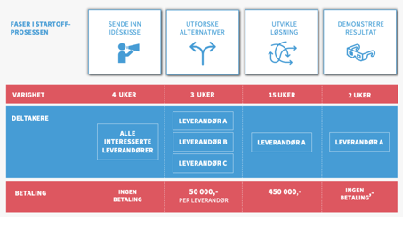

## Description of the case

### Who submitted this case

The case was first presented in connection with the application for MedFin funding. The need has since been confirmed, among other things through the Professional and Prioritisation Committee. Anyone who has had several children in kindergarten/school is also familiar with the problem.

### Brief description of the case

The case concerns creating a simple, shared channel for ongoing dialogue between the home and kindergarten/SFO (out-of-school care)/school, and making it possible for parents and guardians to deal with just one channel.

### What problem does the case address / What works poorly today?

There are many good solutions for communication between kindergarten/SFO and school on the one hand and parents and guardians on the other. Various apps such as Transponder, IST Home, Visma Min Skole, Visma Min barnehage and Showbie have good functionality in themselves. In addition, channels such as SMS, e-mail and traditional letters sent home in the school bag are used.

The problem for parents is keeping track of the number of channels. If you have several children, you risk having to deal with many different apps that do roughly the same thing. It is not even necessarily the case that SFO/AKS (out-of-school care) and the school use the same solution. In addition, individual teachers may use their own channels. Besides being confusing, this also means that the history is lost.

### Where do breakdowns in information flow or responsibility occur?

No one has day-to-day responsibility for the overall communication between the municipality and parents and guardians. Kindergartens, SFO/AKS and schools use the channels they believe work best for their purpose, essentially without taking the recipient into account.

### Who are the primary actors affected

- Parents and guardians
- Pupils
- Staff in kindergartens, SFO/AKS and schools
- System vendors

### What are the consequences for the actors of the current situation.

Good communication is a precondition for good and fruitful involvement from the home throughout the educational pathway. If the act of communicating itself feels burdensome, the threshold for raising issues and contributing actively will be higher. There is also a risk that important information does not get through, but «drowns» in different channels.

The confusing picture also makes it more complicated to handle each parent's right to receive information, especially when the parents do not live together and perhaps communicate poorly with each other.

### A separate legal challenge: dialogue between parents

Most of the regulations and practice concern collaboration between home and school. A dialogue solution will, however, also be used for interaction **between the parents of different children** – class contacts, voluntary work days, birthday invitations, parent groups. Responsibility for this part of the dialogue is not as well clarified as responsibility for home–school collaboration, and must be assessed separately in a pilot.

### What could a desired situation (dream journey) look like?

It is fairly obvious that for parents, the very best would be for all communication concerning the child to go through one channel. The solution must have a low threshold for use, be suitable for mobile devices and be able to integrate with standard calendar solutions.\
For the solution to work and be used to the full, the interface towards kindergarten, SFO/AKS and school must be just as simple and preferably integrated into the line-of-business systems.

An ideal solution should also allow the voluntary sector to use it, so that messages about children taking part in sports clubs, school bands, scouts, dance and other leisure activities are part of the same solution.

### Insight work

SAMT-BU is not aware of any insight work carried out specifically in connection with this case. It is assumed, however, that there is a great deal of knowledge about the needs of parents and guardians both in the municipalities and in the sector more broadly. Even though much of the insight gained often relates to pupils with special needs, it will also be relevant on a more general basis.

### Which of the project's objectives do we consider the case to address?

The case is a very good case for SAMT-BU because it is one of few cases that directly address the needs of end users. Because it concerns giving access to data that users are already entitled to access, it is also assumed that there are few legal obstacles. Since it involves gathering data from many sources and presenting it, the development of shared information models and interfaces will be absolutely central.

Of SAMT-BU's objectives, it addresses:

- Shared information models and standardised interfaces that over time cover «all» areas and sectors.
- Reusable solutions and shared solutions
- Simpler user journeys for staff, parents and guardians, pupils and students throughout the learning pathway - from kindergarten to primary and lower secondary school, upper secondary and higher education.
- Collaboration and innovation across public and private actors in the ecosystem, and increased competition in the market.
- Long-term goals of lifelong learning, etc.
- Scaling and transfer of the project's learning and outputs to other areas and sectors, following piloting in this project.

### A little about implementation

There are already good solutions that technically and functionally cover the needs described above, so it is not a good option for the public sector to start building competing solutions. We believe this is a challenge the market will be able to solve well, and we envisage an ecosystem where different vendors and startups can create different «parent apps» that harvest communication data from the line-of-business systems of the municipality and the voluntary sector. Which business models the vendors choose is naturally up to them, but a key point is that the solutions must be independent of municipal boundaries and of the line-of-business system in each municipality. It is the parents, not the municipality, who choose the solution, and it is the parents' favour the vendors must compete for.

SAMT-BU's task will be to make it possible for the communication data to become available. In a pilot we will therefore have to map which solutions and formats exist and which contractual or regulatory changes are needed to «free» the data. It should also be considered whether data should be made available, for example, through Min Kommune or the KS Digital data platform.

In KS's work on "Approach to a joint procurement of a childhood and education administrative system" (Tilnærming felles anskaffelse oppvekstadministrativt system), requirements for combined communication and dialogue will carry a lot of weight, regardless of vendor and solution. SAMT-BU can contribute here.

To initiate the development of relevant solutions, we intend to look to the StartOff programme. StartOff was a programme for innovative procurement, in which public contracting authorities had solutions developed for their needs through a process specially adapted to start-up companies. The programme has now ended, but this innovative procurement methodology can still be used. (<https://www.anskaffelser.no/innovasjon/startoff>).

The StartOff process is divided into different phases:

- **Phase zero:** before the project starts, StartOff helps define and find the right challenge and scope.
- **Identify needs:** in the first three weeks of the process, the challenge is reformulated as a need, which is articulated in a needs document.
- **Invite idea sketches:** together with the competition rules and the idea sketch template, the needs document and the challenge video are announced as a competition, in which startups have four weeks to submit their idea sketch.
- **Evaluate idea sketches:** The six best idea sketches are selected for interview, and the three best companies are selected for the next phase.
- **Explore alternatives:** In this phase the companies have three weeks to develop a complete solution proposal for a fee of NOK 50,000. At the end of these three weeks the companies pitch their solutions and a winner is chosen.
- **MVP development:** The winning company receives a fee of NOK 450,000 and has 15 weeks to develop a minimum viable product (MVP), which is then demonstrated.
- **The way forward:** Once the MVP is complete, the project moves into an ordinary procurement, further development or other forms of next steps.
